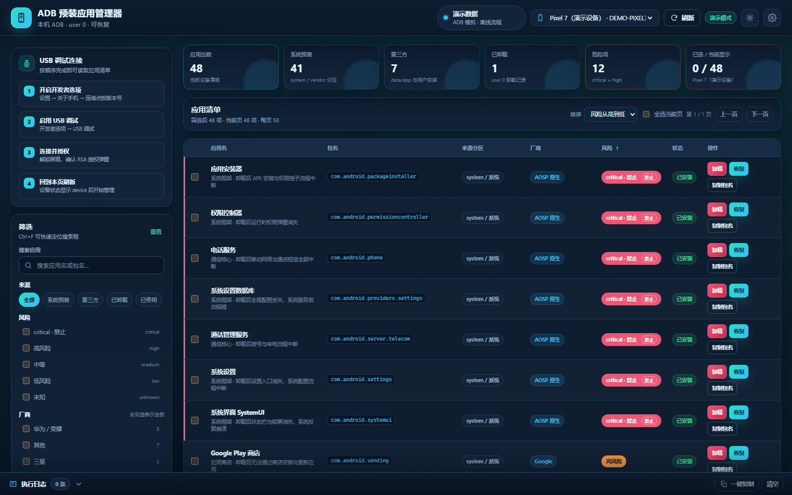

# ADB 预装应用管理器（adb-app-manager）

一个零第三方依赖、完全离线可用的本地 Web 小工具：通过本机的 `adb.exe` 列出 Android 设备上的系统预装应用，按厂商和风险分级展示，勾选后批量执行 `pm uninstall -k --user 0` 精简，随时可恢复。Windows 双击 `start.bat` 一键启动，浏览器打开 `http://127.0.0.1:8787` 即可使用。



> 上图为 `--demo` 演示模式下的实际界面（内置演示设备与 48 条示例应用）。无需 adb、无需真机即可查看完整流程。

## 功能特性

- **设备与 ADB 状态可视**：顶部状态栏显示 adb 路径、版本、端口、演示模式标记，设备下拉列出 serial / 型号 / 产品名 / transportId。
- **全量应用清单**：合并 `pm list packages -f`、`-3`、`-s`、`-d`、`-u` 五组结果，区分「已安装 / 已卸载 / 已禁用」，标注 APK 路径与来源分区（system / system_ext / vendor / product / odm / oem / apex / data）。
- **中文目录与风险分级**：内置 369 条真实常见包名，给出中文名、厂商、风险徽章、卸载影响说明；未收录的包按包名启发式推断厂商并生成可读名称。
- **筛选 / 搜索 / 排序 / 分页**：按名称与包名即时搜索，来源、风险、厂商多选筛选，每页 50 条。
- **六套预设方案**：小米、华为、OPPO、vivo、三星、Google，一键勾选方案中仍已安装的 low/medium 项。
- **批量卸载与恢复**：逐包调用接口，实时进度条、逐条结果与可复制的实际 adb 命令日志。
- **APK 提取到本地**：单包、勾选批量、按预设或筛选结果整批提取，`pm path` + `adb pull` 落到 `exports/<serial>/<包名>/`，可一键在系统文件管理器中打开。
- **split APK 全量提取**：`pm path` 返回几行就拉几个（实测 Bard 6 行、Chrome 5 行），`base.apk` 与全部 `split_config.*.apk` 一起保存，装回时用 `adb install-multiple` 一次装入。
- **导出记录与校验**：每个文件记录大小与 SHA-256，`GET /api/apk/exports` 可查看清单；已存在且非空的文件默认跳过，重复执行不重复传输。
- **危险确认**：critical/high 项需勾选「我已了解风险」并输入 `确认卸载`；critical 默认不勾选并带「禁止」标记，`force:false` 时后端硬阻断。
- **操作历史**：`data/history.json` 按时间倒序保留最多 500 条卸载/恢复记录，支持一键清空。
- **演示模式**：内置一台假设备与约 40 条示例应用，卸载与恢复在内存中模拟，方便无设备时验证 UI 与流程。
- **离线可用**：无 npm 依赖、无 CDN 外链，纯原生 HTML/CSS/JS + Node.js 内置模块。

## 原理说明

核心命令是 Android 的用户级卸载：

```text
adb -s <SERIAL> shell pm uninstall -k --user 0 <包名>
```

- `--user 0`：卸载**只对当前用户（user 0）生效**，其他用户/工作资料不受影响。
- `-k`：保留该应用的数据与缓存；界面上「保留数据」开关关闭时去掉 `-k`。
- **system 分区里的 APK 文件没有被删除**，只是为 user 0 打了「已卸载」标记，所以分区不会被改写，也不需要 root。
- 恢复走系统自带的 `cmd package install-existing <包名>`（失败时回退 `pm install-existing`，再回退历史记录里的 `pm install -r --user 0 <apkPath>`），把该用户下的标记撤销即可。

因此这套操作是可逆的：重启、OTA 升级通常不会让已卸载项自动回来；恢复出厂设置则会把 user 0 的卸载标记清掉，所有预装应用重新出现。

提取 APK 走的是另一条只读通道：不改动设备上的安装状态，只把分区里的文件复制到电脑，详见下一章。

## 提取手机中的 APK

卸载与提取互不干扰：卸载只改 user 0 的安装状态，提取则通过 `pm path` + `adb pull` 把设备上的 APK 文件原样复制到本机。由于 system / system_ext / product 分区里的 APK 从未被删除，**已为 user 0 卸载的预装应用照样能提取**——在 Android 14 HyperOS（23127PN0CC）上实测 `pm path com.miui.yellowpage` 仍返回 `/product/priv-app/MIUIYellowPage/MIUIYellowPage.apk`。这一步不需要 root。

### 原理与命令

先用 `pm path` 拿到设备上的完整路径，输出每行带一个 `package:` 前缀：

```powershell
& 'D:\tools\platform-tools\adb.exe' -s SERIAL shell pm path com.android.settings
# package:/system_ext/priv-app/Settings/Settings.apk

& 'D:\tools\platform-tools\adb.exe' -s SERIAL shell pm path com.google.android.apps.bard
# package:/data/app/.../base.apk
# package:/data/app/.../split_config.arm64_v8a.apk
# ... 共 6 行
```

再逐行 `adb pull` 到本机，工具默认落到 `exports/<serial>/<包名>/`：

```powershell
& 'D:\tools\platform-tools\adb.exe' -s SERIAL pull /system_ext/priv-app/Settings/Settings.apk 'exports\23127PN0CC\com.android.settings\Settings.apk'
```

对应的接口：

| 接口 | 作用 |
| --- | --- |
| `GET /api/apk/paths?pkg=<包名>` | 解析 `pm path`，返回全部 APK 设备路径（split 全量） |
| `POST /api/apk/pull` | 单包或包列表批量 pull，写入 `exports/<serial>/<包名>/`，记录每个文件的大小与 SHA-256；`skipExisting` 默认开启 |
| `GET /api/apk/exports` | 列出本机导出记录：设备、包名、文件名、大小、SHA-256、提取时间 |
| `POST /api/apk/open` | 在系统文件管理器中打开导出目录 |
| `GET /api/health` | 新增 `exportsDir` 字段，显示当前导出根目录 |

### split APK：几行就拉几个

现代应用多用 App Bundle 发布，`pm path` 返回多行时每一行都是必须一起安装的分片。只取 `base.apk` 装回会缺资源或直接安装失败，所以工具把全部行都 pull，不做筛选。

| 输出 | 含义 | 工具处理 |
| --- | --- | --- |
| `package:/.../base.apk` | 主包，含代码与 Manifest | 必须提取，装回时作为 `install-multiple` 参数之一 |
| `package:/.../split_config.arm64_v8a.apk` | ABI 架构相关的 so / 资源 | 一并提取 |
| `package:/.../split_config.en.apk`、`split_config.es.apk`、`split_config.zh.apk` | 语言资源 | 一并提取 |
| `package:/.../split_config.xxhdpi.apk` | 屏幕密度资源 | 一并提取 |
| 只有一行 | 传统单 APK，常见于系统预装 | pull 这一个即可 |

真机实测（23127PN0CC / Android 14 / HyperOS）：

| 包名 | `pm path` 行数 | 文件 |
| --- | --- | --- |
| `com.google.android.apps.bard` | 6 | `base.apk` + `split_config.arm64_v8a` / `en` / `es` / `xxhdpi` / `zh` |
| `com.android.chrome` | 5 | `base.apk` + 4 个 `split_config.*` |
| `com.miui.yellowpage`（已为 user 0 卸载） | 1 | `/product/priv-app/MIUIYellowPage/MIUIYellowPage.apk` |

### 导出目录

```text
exports/                                  # 运行时生成，已被 .gitignore 忽略
└── 42c10f84/                            # 设备 serial
    ├── com.android.chrome/
    │   ├── base.apk
    │   ├── split_config.arm64_v8a.apk
    │   ├── split_config.en.apk
    │   ├── split_config.xxhdpi.apk
    │   └── split_config.zh.apk
    └── com.miui.yellowpage/
        └── MIUIYellowPage.apk
```

每个文件在 `GET /api/apk/exports` 的记录里带 `size`（字节）与 `sha256`，可复制校验值核对文件完整性；导出总大小随提取数量增长，定期清理即可。

### 界面操作步骤

1. **单包提取**：在应用表格行的操作列点「提取 APK」→ 后端先 `GET /api/apk/paths?pkg=` 取全部路径 → `POST /api/apk/pull` 逐个 `adb pull`；日志抽屉显示每个文件的实际命令、字节数与 SHA-256。
2. **勾选批量**：勾选多包 → 批量栏「批量提取」；也可先点预设方案，或按来源 / 风险 / 厂商筛出结果后整批勾选再提取，逐包顺序执行并显示进度条。
3. **打开文件夹**：导出面板点「打开导出目录」→ `POST /api/apk/open`，在系统文件管理器里定位到 `exports/<serial>/<包名>/`。
4. **查看导出记录**：打开导出面板（数据来自 `GET /api/apk/exports`），按设备与包名分组查看文件名、大小、SHA-256，可复制路径或校验值；重复提取同一包时已存在且非空的文件默认跳过。
5. **确认结果**：`GET /api/health` 的 `exportsDir` 显示当前导出根目录，方便在终端里直接跳转。

### 装回手机

把某个包的全部 APK 一次交给 `adb install-multiple`，顺序无关，缺分片会安装失败：

```powershell
# PATH 中已配置 adb 时
adb install-multiple (Get-ChildItem 'exports\42c10f84\com.android.chrome\*.apk').FullName

# 用完整路径并指定设备
& 'D:\tools\platform-tools\adb.exe' -s SERIAL install-multiple (Get-ChildItem 'exports\42c10f84\com.android.chrome\*.apk').FullName

# 单 APK 的预装应用同样走 install-multiple
& 'D:\tools\platform-tools\adb.exe' -s SERIAL install-multiple (Get-ChildItem 'exports\42c10f84\com.miui.yellowpage\*.apk').FullName
```

### 手工单包提取

不经过界面时，用一段 PowerShell 把某个包的全部 APK 拉到本机并算校验值：

```powershell
$serial = '23127PN0CC'
$pkg    = 'com.miui.yellowpage'
$adb    = 'D:\tools\platform-tools\adb.exe'
$dest   = "exports\$serial\$pkg"
New-Item -ItemType Directory -Force -Path $dest | Out-Null
& $adb -s $serial shell pm path $pkg | ForEach-Object {
  $devicePath = ($_ -replace '^package:', '').Trim()
  if ($devicePath) { & $adb -s $serial pull $devicePath (Join-Path $dest (Split-Path $devicePath -Leaf)) }
}
Get-ChildItem $dest | Select-Object Name, Length
Get-FileHash (Join-Path $dest 'MIUIYellowPage.apk') -Algorithm SHA256
```

### 大文件、超时与跳过策略

- Chrome、Google 服务这类包单文件可达数百 MB，USB 2.0 下拉取需要几十秒；批量任务按文件顺序执行，界面有进度条与防重复点击。
- `adb pull` 这类传输命令在后端自动使用不低于 180000 ms 的超时，无需手动调整；设置弹窗里的子进程超时（1000~120000 ms，默认 15000 ms）作用于 `pm list packages` / `pm path` / 卸载与恢复等普通命令。大文件优先用数据线，无线调试下容易掉到 `offline`。
- `skipExisting` 默认开启：目标文件已存在且非空即跳过，重跑同一批只补缺失项，中断后可以接着来。需要强制重新提取时清空对应目录或关闭跳过选项。
- 提取前确认本机磁盘空间充足；`exports/` 体积增长快且已被 `.gitignore` 忽略，不会进版本库。

## 环境要求

| 项目 | 要求 |
| --- | --- |
| Node.js | >= 18（ESM，`.mjs` / `"type":"module"`） |
| npm 依赖 | 无，`dependencies` 为空对象 |
| ADB | Android SDK Platform Tools 里的 `adb.exe`（建议 30.0.0 以上，无线调试需要） |
| 手机 | 开启开发者选项与 USB 调试，并在 RSA 授权弹窗点「允许」，详见 [USB 调试指南](docs/USB调试指南.md) |
| 系统 | Windows 为主（提供 `start.bat`），macOS / Linux 用 `start.sh` |
| 浏览器 | 任意现代浏览器，访问 `http://127.0.0.1:8787` |

## 三种启动方式

```powershell
# 方式一：Windows 一键启动（推荐，自动切到脚本目录并打开浏览器）
cd D:\workspace\adb-app-manager
.\start.bat

# 方式二：npm start（等价 node server.mjs）
npm start

# 方式三：演示模式，无需 adb 与真机
npm run demo
node server.mjs --demo --open

# 其它常用参数
node server.mjs --port 9000
node server.mjs --adb 'D:\tools\platform-tools\adb.exe'
node server.mjs --demo --open --port 9000
```

| 参数 / 环境变量 | 作用 |
| --- | --- |
| `--port <n>` / `PORT` | 覆盖默认端口 8787 |
| `--adb <path>` / `ADB_PATH` | 指定 adb 可执行文件 |
| `--open` | 启动后自动打开浏览器 |
| `--demo` | 演示模式，内置假设备与假应用 |

服务默认只监听 `127.0.0.1`，所有 `/api/*` 响应为 JSON（`Content-Type: application/json; charset=utf-8`），静态资源来自 `public/`。

## 首次使用 5 步流程

1. **装 Node 与 platform-tools**：`node --version` 确认 >= 18；解压 platform-tools 到任意目录，例如 `D:\tools\platform-tools\adb.exe`。
2. **手机开启 USB 调试**：连点版本号进入开发者选项，打开 USB 调试，数据线连接后选择「传输文件(MTP)」，按 [USB 调试指南](docs/USB调试指南.md) 完成 RSA 授权。
3. **启动工具**：双击 `start.bat`（或 `npm start`），浏览器自动打开 `http://127.0.0.1:8787`。
4. **确认设备**：顶部状态栏看到 adb 路径与版本，设备下拉选中状态为 `device` 的那台；点「刷新」拉取应用列表。
5. **勾选并卸载**：用左侧预设方案或搜索勾选目标 → 查看每条 note 的风险说明 → 「批量卸载」→ 在确认弹窗完成校验 → 看日志抽屉里的逐条结果与命令。

排错时可直接验证 adb：

```powershell
& 'D:\tools\platform-tools\adb.exe' devices -l
& 'D:\tools\platform-tools\adb.exe' shell pm list packages -3
```

## ADB 路径配置说明

工具按以下顺序解析 adb，命中即停：

1. CLI `--adb <path>` 或环境变量 `ADB_PATH`
2. `data/config.json` 的 `adbPath`
3. PATH 里的 `adb`（用 `where` / `which` 判定）
4. 常见目录探测：Windows 下 `%USERPROFILE%\Downloads\platform-tools-latest-windows\platform-tools\adb.exe`、`%LOCALAPPDATA%\Android\Sdk\platform-tools\adb.exe`、`C:\platform-tools\adb.exe`；macOS / Linux 下 `~/Library/Android/sdk/platform-tools/adb`、`~/Android/Sdk/platform-tools/adb`、`/usr/bin/adb`、`/opt/platform-tools/adb`
5. 都未命中 → `/api/health` 返回 `adbPath:null` 与 `adbError`，界面显示「设置 ADB 路径」引导卡片

配置方式任选其一：

```powershell
# 临时：环境变量仅对当前终端生效
$env:ADB_PATH = 'D:\tools\platform-tools\adb.exe'
npm start

# 临时：命令行参数
node server.mjs --adb 'D:\tools\platform-tools\adb.exe'

# 持久：界面右上角齿轮 → 设置弹窗 → 填 ADB 路径或点「自动探测」→ 保存
# 保存结果写入 data/config.json（已被 .gitignore 忽略）
```

仓库内提供 `config.example.json` 作为字段示例；`data/` 由运行时生成，本地配置不会进版本库。设置弹窗同时可调整子进程超时（1000~120000 ms，默认 15000 ms）与主题。

## 预设方案用法

左侧「预设方案」列出六组，每组 20~45 个包名，只收录 `low` / `medium` 风险项，绝不收录 critical：

| Key | 名称 | 覆盖 |
| --- | --- | --- |
| `xiaomi` | 小米 / Redmi 精简 | MIUI / HyperOS 广告、反馈、在线内容、商城、负一屏 |
| `huawei` | 华为 / 荣耀精简 | 预置影音、书城、天气、生活服务、广告模块 |
| `oppo` | OPPO / 一加 / realme 精简 | ColorOS / realme UI 内容应用、商城、游戏空间、负一屏 |
| `vivo` | vivo / iQOO 精简 | 预置影音、天气、便签、主题、互传 |
| `samsung` | 三星 One UI 精简 | Bixby 系列、主题商店、预置办公与内容应用 |
| `google` | Google 全家桶精简 | Play 影音、办公套件、壁纸与搜索类客户端 |

点击方案 → 自动勾选该方案中仍处于 `installed` 的包并滚动到表格，toast 提示勾选数量；之后仍可手动增减勾选再执行。方案本身不改动设备，只影响界面选择。想导出自定义组合，用批量栏的「导出方案 JSON」。

## 风险分级说明

| 级别 | 含义 | 界面标记 | 后端行为 |
| --- | --- | --- | --- |
| `critical` | 系统框架与核心数据库，卸载会导致开机卡住、桌面崩溃或通信中断 | 禁止（默认不勾选） | `force:false` 时单条返回 `核心组件，已阻止（需 force）` |
| `high` | 强依赖组件，卸载后某项核心能力缺失（相机、拨号、推送、WebView 等） | 危险 | 需勾选确认并输入 `确认卸载`，`dangerous:true` |
| `medium` | 有明显功能影响，如预置浏览器、应用商店、输入法、默认短信 | 提醒 | 正常执行，建议先看 note |
| `low` | 预装内容、广告、在线服务、反馈与商城类 | 安全 | 可直接精简 |
| `unknown` | 未收录于目录的包 | 未知 | 按包名启发式推断厂商，`dangerous:false`，请自行确认 |

`gms` / `vending` / `webview` / 开机向导统一归为 `high`：提示风险但不在 `CRITICAL_PACKAGES` 硬阻断集合里。每条 note 都以「卸载后」开头写明实际影响，危险项写明后果；勾选前把鼠标停在行上看一眼是最省事的习惯。

## 恢复已卸载应用的步骤

1. 左侧范围筛选切到「已卸载」（后端用 `pm list packages -u` 全集减去已安装集算出）。
2. 勾选要恢复的包 → 「批量恢复」。
3. 后端逐条依次尝试：`cmd package install-existing <pkg>` → `pm install-existing <pkg>` → 历史里有 `apkPath` 且文件仍在时用 `pm install -r --user 0 <apkPath>`；成功后写 `action:"restore"` 历史。
4. 点「刷新」确认状态回到 `installed`；历史抽屉可查看每条命令与输出。

手工恢复（把 `SERIAL` 换成 `adb devices -l` 里的实际 serial）：

```powershell
& 'D:\tools\platform-tools\adb.exe' -s SERIAL shell cmd package install-existing com.miui.bugreport
& 'D:\tools\platform-tools\adb.exe' -s SERIAL shell pm install-existing com.miui.bugreport
& 'D:\tools\platform-tools\adb.exe' -s SERIAL shell pm path com.miui.bugreport
& 'D:\tools\platform-tools\adb.exe' -s SERIAL shell pm install -r --user 0 /system/priv-app/MiuiBugReport/MiuiBugReport.apk
& 'D:\tools\platform-tools\adb.exe' -s SERIAL shell pm list packages com.miui.bugreport
```

## 常见问题

**设备显示 `unauthorized`**
手机端 RSA 授权弹窗未确认。解锁屏幕 → 切换 USB 模式为「传输文件」→ 重新插拔 → 弹窗勾选「一律允许使用这台计算机进行调试」→ 确定。仍不行就在开发者选项里点「撤销 USB 调试授权」再重连，然后重启 adb 服务：

```powershell
& 'D:\tools\platform-tools\adb.exe' kill-server
& 'D:\tools\platform-tools\adb.exe' start-server
& 'D:\tools\platform-tools\adb.exe' devices -l
```

**设备显示 `offline` 或列表为空**
多为 platform-tools 版本过旧、线缆只供电、USB 模式停在「仅充电」或 5037 端口被占用。升级 platform-tools 到最新版、换一根数据线、选 MTP 模式、重启 adb 服务、重新授权；Windows 下检查手机驱动是否装好。

**找不到 adb / `/api/health` 里 `adbPath:null`**
用设置弹窗填 `adb.exe` 完整路径或点「自动探测」；也可 `--adb`、`$env:ADB_PATH`、`data/config.json` 的 `adbPath` 三选一。保存后接口会重新探测并返回新 health。

```powershell
where.exe adb
& 'D:\tools\platform-tools\adb.exe' version
```

**卸载后开机向导卡住 / 恢复出厂后卡在初始化**
向导类包（`com.google.android.setupwizard`、`com.huawei.hwstartupguide`、`com.sec.android.app.secsetupwizard` 等）被一并卸载时会出现。先恢复向导包：

```powershell
& 'D:\tools\platform-tools\adb.exe' -s SERIAL shell cmd package install-existing com.google.android.setupwizard
& 'D:\tools\platform-tools\adb.exe' -s SERIAL shell settings put secure user_setup_complete 1
& 'D:\tools\platform-tools\adb.exe' -s SERIAL shell settings put global device_provisioned 1
& 'D:\tools\platform-tools\adb.exe' -s SERIAL reboot
```

若仍停在向导页，进 Recovery 恢复出厂设置即可重建 user 0（这也会清掉所有卸载标记）。

**恢复失败 / `install-existing` 报 Failure**
`install-existing` 只对系统分区里仍存在的预装包有效；第三方应用被 `--user 0` 卸载后，用 `pm path <pkg>` 查 APK 路径再 `pm install -r --user 0 <apkPath>`，或直接重装 APK。极少数 ROM 删除了 user 0 的包记录时，恢复出厂设置是最彻底的办法。历史抽屉里的 `apkPath` 字段可直接复制使用。

**请求很慢 / 按钮点了没反应**
采集五组 `pm list packages` 命令可能超过 10 秒，界面有 loading 态与防重复点击；结果缓存 60 秒，`refresh=1` 强制重采，卸载/恢复后自动失效。子进程默认超时 15000 ms，可在设置里调大。

**`pm path` 返回空或多行**
空输出多为包名写错、设备里确实没有这个包，或当前用户下没有可读取的 APK 路径；用 `pm list packages <关键字>` 核对包名即可。已为 user 0 卸载的预装应用仍会正常返回路径，因为 APK 文件还在 system / product 分区。多行输出则是 split APK / App Bundle，每行一个分片，全部都要 pull；只取 `base.apk` 装回会缺资源或安装失败。行首的 `package:` 是固定前缀，工具会自动去掉再 pull。

```powershell
& 'D:\tools\platform-tools\adb.exe' -s SERIAL shell pm list packages miui
& 'D:\tools\platform-tools\adb.exe' -s SERIAL shell pm path com.google.android.apps.bard
```

**提取大 APK 慢或失败**
`adb pull` 传输命令在后端自动使用不低于 180000 ms 的超时，检查本机剩余磁盘空间与 USB 连接即可；设置弹窗里的子进程超时（默认 15000 ms，范围 1000~120000 ms）作用于 `pm list packages` / `pm path` 等普通命令，大批量提取优先用数据线，无线调试下容易掉到 `offline`。失败后看日志抽屉里的 adb 输出与导出记录里已成功的文件，`skipExisting` 会跳过已存在且非空的文件，修好连接后重跑同一批即可接着来。目标目录不存在时工具会自动创建；清理 `exports/` 下对应目录即可重新开始。

```powershell
Invoke-RestMethod 'http://127.0.0.1:8787/api/health' | Select-Object exportsDir, adbPath, demo
Invoke-RestMethod 'http://127.0.0.1:8787/api/apk/exports' | ConvertTo-Json -Depth 6
Get-PSDrive -PSProvider FileSystem | Select-Object Name, Used, Free
```

## 目录结构

```text
adb-app-manager/
├── server.mjs                # HTTP 服务与 REST API
├── start.bat / start.sh      # 一键启动脚本
├── package.json              # ESM，零依赖
├── config.example.json       # 本地配置示例
├── README.md
├── LICENSE                   # MIT
├── .gitignore
├── lib/
│   ├── adb.mjs               # adb 探测与子进程封装
│   ├── store.mjs             # config / history 读写
│   ├── catalog.mjs           # 应用目录、预设、风险分级、lookup / detectVendor
│   └── pull.mjs              # pm path / adb pull / 大小与 SHA-256 导出记录
├── public/
│   ├── index.html
│   ├── styles.css
│   └── app.js
├── docs/
│   ├── USB调试指南.md
│   └── screenshots/main.png  # 主界面截图
├── exports/                  # 提取的 APK，运行时生成，已被 .gitignore 忽略
│   └── <serial>/<包名>/      # base.apk + split_config.*.apk
└── data/                     # 运行时生成，已被 .gitignore 忽略
    ├── config.json
    └── history.json
```

`lib/pull.mjs` 负责 `pm path` 解析、`adb pull` 与导出记录（文件大小、SHA-256）；`exports/` 与 `data/` 均为运行时生成，已被 `.gitignore` 忽略，提取出来的 APK 不会进版本库。

## 免责与许可

操作前建议备份数据，卸载影响以每条 note 为准；本项目按 MIT 许可开源，具体条款见 [LICENSE](LICENSE)。

## 许可

MIT License，Copyright (c) 2026 `adb-app-manager contributors`。允许自由使用、复制、修改、合并、出版发行、再授权与销售，只需保留版权声明与许可声明；软件按「原样」提供，不含任何明示或暗示担保。完整文本见 [LICENSE](LICENSE)。
